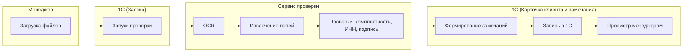
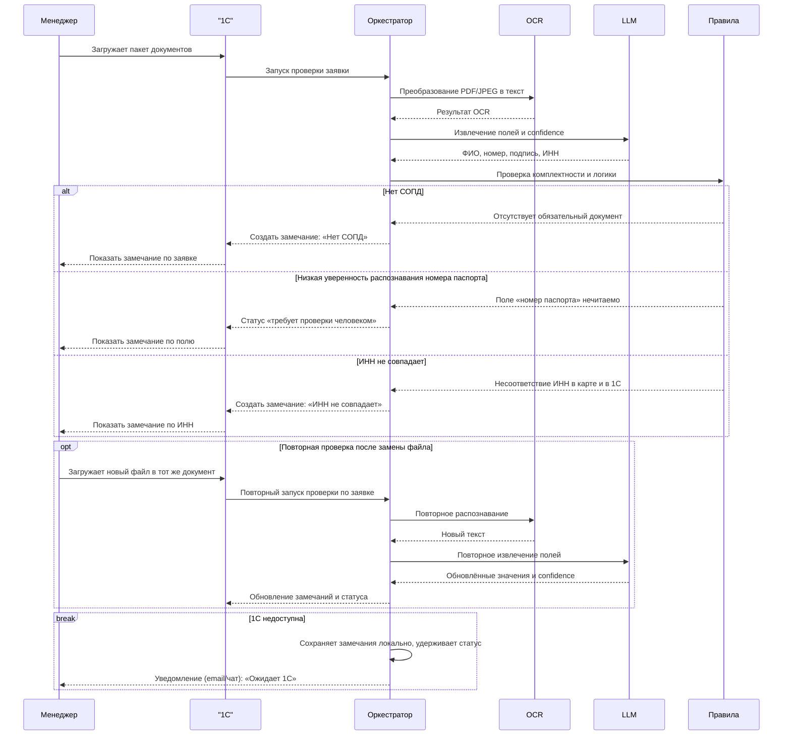

# lease-docs-pilot

# Тестовое задание: проверка документов лизинговой сделки (пилот)

## 0. Контекст и границы пилота (кратко)
Пилот реализует автоматическую предварительную проверку пакета документов клиента до передачи в процесс кредитного анализа и СБ. В рамках эксперимента рассматриваются только три документа: паспорт руководителя, СОПД и карта партнёра; допустимые форматы — PDF и JPEG; карточка клиента в 1С уже существует. Вне границ пилота остаются иные типы документов и проверки, не относящиеся к учебному сценарию. Все правила являются учебными: обязательны три документа, из паспорта извлекаются ФИО и номер, у СОПД проверяется видимая подпись, ИНН из карты партнёра должен совпадать с ИНН в 1С, а нечитаемые поля переводятся в статус «требует проверки человеком»; печать не обязательна.

## 1. Путь от файлов в заявке до замечаний в 1С


Основной поток начинается с загрузки документов менеджером в заявку 1С и запуска проверки. Далее файл проходит OCR и извлечение полей, после чего модуль правил сопоставляет данные с требованиями пилота. Результат оформляется в виде замечаний, которые фиксируются в карточке клиента и доступны менеджеру для дальнейшего согласования. Повторный запуск выполняется после замены или дополнения файла.

## 2. Компоненты и их роль (OCR / ИИ / правила)
| Компонент | Роль | Тип (OCR / ИИ / Правила) |
| --- | --- | --- |
| 1С | Хранение заявки, карточки клиента и замечаний, пользовательский интерфейс для менеджера | Правила |
| Оркестратор | Управление процессом проверки, маршрутизация задач между сервисами и контроль статусов | Правила |
| OCR-сервис | Распознавание текста из PDF/JPEG и подготовка текстового слоя для дальнейшей обработки | OCR |
| LLM (Извлечение) | Извлечение структурированных полей из текста документа с оценкой уверенности | ИИ |
| Модуль правил | Проверка комплектности, подписи, совпадения ИНН и формирование замечаний | Правила |
| Хранилище файлов | Хранение исходных документов, результатов OCR и метаданных проверки в пределах контура | Правила |

## 3. Пример результата и защита от выдуманных значений
```json
{
  "document_type": "passport_lead",
  "fields": {
    "ФИО": {
      "value": "Иванов Иван Иванович",
      "confidence": 0.97
    },
    "номер_паспорта": {
      "value": "4512 345678",
      "confidence": 0.74
    }
  },
  "status": "ok",
  "source_file": "lead_passport_001.pdf",
  "page": 1
}
```

Логика защиты от галлюцинаций следующая: если уверенность распознавания ниже порога, поле не подставляется как «достоверное значение», а сохраняется как `null` и статус документа переводится в состояние «требует проверки человеком». Это исключает подмену неразборчивых данных предположениями модели и сохраняет контроль у специалиста. Для критичных полей, таких как номер паспорта или ИНН, приоритет отдаётся безопасному исходу: отсутствие распознанного значения лучше, чем неточная догадка.

## 4. Разбор ситуаций, повторная проверка, сбои


Ветка «Нет СОПД» фиксирует отсутствие обязательного документа и приводит к замечанию, которое видно менеджеру в форме заявки. Для размытого номера паспорта правило анализирует показатель confidence: если он ниже порога, поле считается нечитаемым и ставится статус «требует проверки человеком». Ветвь «ИНН не совпадает» сравнивает значение из карты партнёра с актуальными данными карточки клиента в 1С и формирует замечание о несоответствии. Повторная проверка после замены файла — идемпотентный перезапуск по заявке. При недоступности 1С замечания накапливаются локально, а заявка остаётся в статусе «ожидает 1С» без потери данных.

## 5. Качество, метрики пилота, план на 3 месяца, ПДн
| Метрика | Описание | Способ проверки |
| --- | --- | --- |
| Точность извлечения полей | Доля корректно распознанных ФИО, номера паспорта, ИНН и признака подписи по сравнению с экспертной разметкой | Оценка на репрезентативной обезличенной выборке документов с вручную проверенной разметкой |
| Доля ложных замечаний | Отношение ошибочно сформированных замечаний к общему числу проверок | Ручной аудит случайной выборки заявок и сравнительный анализ с экспертной оценкой |
| Время проверки | Среднее время от загрузки файла до записи замечаний в 1С | Сбор метрик по заявкам в журнале оркестратора и анализ SLA по этапам обработки |

| Требование | Как реализуется в пилоте |
| --- | --- |
| Деперсонализация | До передачи во внешнюю LLM и OCR документы обезличаются по возможности, а идентифицирующие данные минимизируются; в логах сохраняются только служебные идентификаторы, без персональных данных |
| 152-ФЗ и договор с внешним сервисом | Использование внешнего сервиса допускается только при наличии правового основания, согласованного договора/ DPA, описания целей обработки и перечня данных |
| Хранение и доступ | Исходные файлы и результаты распознавания хранятся в защищённом контуре, доступ к ним ограничен ролями и журналируется |
| Маскирование и аудит логов | Логи, метрики и ошибки очищаются от персональных данных, а все обращения к внешним сервисам фиксируются для аудита и контроля |

Основной план внедрения на 3 месяца строится по этапам: в первый месяц — подготовка контуров, формирование эталонной выборки документов и фиксация учебных правил; во второй месяц — настройка OCR, LLM-извлечения, правил проверки и интеграция с 1С на тестовой заявке; в третий месяц — пилотное использование в ограниченном объёме, оценка метрик качества и корректировка порогов confidence, замечаний и ошибок. По результатам пилота принимается решение о масштабировании на более широкий круг документов и типовых сценариев. 

## Приложение (опционально): допущения и риски
- Учебные правила пилота не равны реальным требованиям бизнес-процесса: в промышленной эксплуатации могут появиться дополнительные обязательные документы, уровни проверки и критерии приемки.
- В репозитории и задаче отсутствуют точные данные по объёму заявок, срокам обработки, уровню качества исходных документов и правилам актуальности данных в карточке клиента.
- Качество распознавания зависит от разрешения, качества сканов и наличия видимой подписи; это повышает риск ошибок при низком качестве PDF/JPEG.
- Использование внешних OCR/LLM-сервисов накладывает риски по данным, правовым основаниям и доступности сервисов; для пилота важно предусмотреть резервный сценарий и локальное хранение критических метаданных.

## 6. Использованные ИИ-инструменты и самостоятельная проверка

Для реализации использовался **GitHub Copilot** в режиме и Agent для IDE и DeepSeek формирования базовой аналитики и плана выполнения.
Архитектурная логика решения, выбор компонентов и границы пилота были спроектированы и провалидированы самостоятельно.

**Что было проверено:**
*   **Архитектура и логика:** сценарий сбоя 1С (добавлено альтернативное уведомление менеджера, так как при недоступности 1С передача статуса через неё невозможна). Проверена логика защиты от галлюцинаций ИИ (возврат `null` при низком confidence).
*   **Синтаксис Mermaid:** идентификаторы `subgraph` и `participant` для 100% корректного рендеринга на GitHub (кириллица и цифры должны быть обернуты в кавычки).
*   **Валидация данных и текста:** Проверен формат JSON-примера и вычитан текст для коррекции опечаток.
*   Для внесения точечных правок по итогам проверок был сформирован промпт агенту.